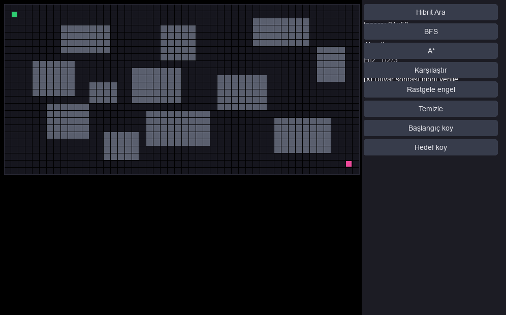
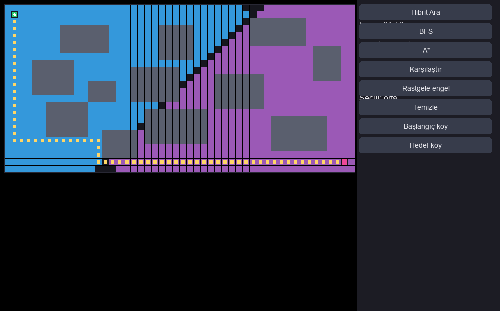
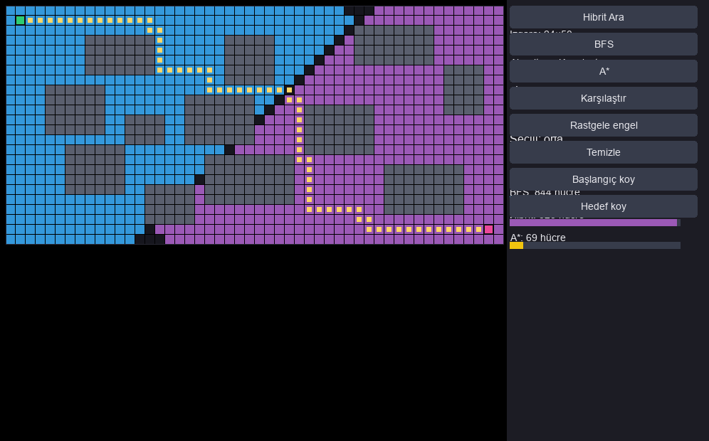

# Labirentte Yol Bulan Ajan

## Proje ne yapıyor

Bu proje, **24×50** hücrelik bir ızgara labirentinde en kısa yolu bulan ve süreci **pygame** ile görselleştiren bir ajandır. Kullanıcı fare ile duvar ekleyip silebilir; başlangıç ve hedef noktalarını değiştirebilir. Üç yol bulma yöntemi vardır:

- **BFS** — klasik genişlik öncelikli arama (birim maliyetli ızgarada optimal).
- **Hibrit** — başlangıçtan ileri BFS dalgası ile hedeften geriye **dinamik akış alanı** (ters BFS / Bellman) birleştirilir; dalgalar derinlik seviyesi seviyesi genişler, önce daha sığ dalga açılır (eşitlikte ileri dalga). İlk buluşma noktasında en kısa yol birleştirilir.
- **A\*** (bonus) — Manhattan sezgiseli ile optimal arama.

Arama adımları renkli olarak animasyonlu çizilir; yol bulununca küçük bir ajan noktası yolu yürür. **Karşılaştır** modu üç algoritmanın kaç hücre “genişlettiğini” yan yana gösterir.

## Nasıl çalıştırılır

```bash
pip install -r requirements.txt
python3 main.py
```

Testler (pygame gerekmez):

```bash
python3 test_algorithms.py
```

## Kontroller

| Girdi | Eylem |
|--------|--------|
| Sol sürükle | Duvar boya |
| Sağ sürükle | Duvar sil |
| **Hibrit Ara** / Boşluk | Hibrit arama animasyonu |
| **BFS** / **B** | BFS animasyonu |
| **A\*** / **A** | A\* animasyonu |
| **Karşılaştır** / **C** | Üç algoritmayı çalıştır, tablo/bar |
| **Rastgele engel** / **M** | En az 8 dikdörtgen engel (yol yoksa yeniden dene) |
| **Temizle** / **R** | Tüm duvarları kaldır |
| **Başlangıç koy** / **Hedef koy** | Mod açıkken ızgaraya tıkla |
| **1 / 2 / 3** | Animasyon hızı (yavaş / orta / hızlı) |
| **T** | Duvar bitince otomatik hibrit yenileme aç/kapa |
| **Esc** | Çıkış |

Varsayılan başlangıç **(1, 1)**, hedef **(22, 48)** (satır, sütun).

## Hibrit yöntem

1. **İleri dalga (BFS):** Başlangıçtan 4-komşu BFS; genişletilen hücreler mavi tonunda.
2. **Geri dalga (dinamik):** Hedeften ters yönde aynı BFS mantığı (birim maliyette optimal alt maliyet alanı); mor tonunda.
3. Her adımda iki dalganın **mevcut derinliği** karşılaştırılır; daha sığ olan (eşitlikte ileri) bir seviye genişletilir.
4. İki dalga aynı hücrede **ilk kez** buluştuğunda, birim maliyetli ızgarada bu buluşma en kısa yol uzunluğuna karşılık gelir. Yol, ileri ebeveynler + buluşma + geri ebeveynler ile birleştirilir (buluşma hücresi tekrarlanmaz).
5. Kullanıcı duvar çizip bıraktığında (veya otomatik yenileme açıksa) hibrit arama **yeniden** planlanır — dinamik yeniden planlama.

## A\* bonusu ve karşılaştırma

**Varsayılan labirent** (12 ayrı dikdörtgen engel bölgesi, sabit yerleşim) üzerinde ölçülen değerler:

| Algoritma | Genişletilen hücre | Yol adımı |
|-----------|-------------------|-----------|
| BFS | 844 | 68 |
| Hibrit | 828 (ileri: 418, geri: 410) | 68 |
| A\* | 69 | 68 |

Üç yöntem de **aynı en kısa yol uzunluğunu** (68 adım) verir. A\* sezgisel sayesinde çok daha az hücre genişletir; hibrit, tek yönlü BFS’e göre biraz daha az hücreye bakarak aynı optimal yolu üretir (iki yönlü buluşma).

## Ekran görüntüleri







## Veri

Bu proje harici bir veri seti üzerinde **eğitim yapmaz**; veri, kullanıcının düzenlediği ızgara labirentinin kendisidir. Örnek harita, [Moving AI Lab maze pathfinding benchmarks](https://movingai.com/benchmarks/maze/) ile uyumlu metin formatında saklanır:

- `data/ornek_labirent.map` — varsayılan engel düzeni (`.` açık, `@` duvar).

## Dosya yapısı

- `main.py` — pygame arayüzü
- `algorithms.py` — BFS, A\*, hibrit arama
- `search_animation.py` — animasyon için adım adım jeneratörler
- `maze_defaults.py` — sabit varsayılan engeller ve rastgele engel üretimi
- `test_algorithms.py` — birim testleri
